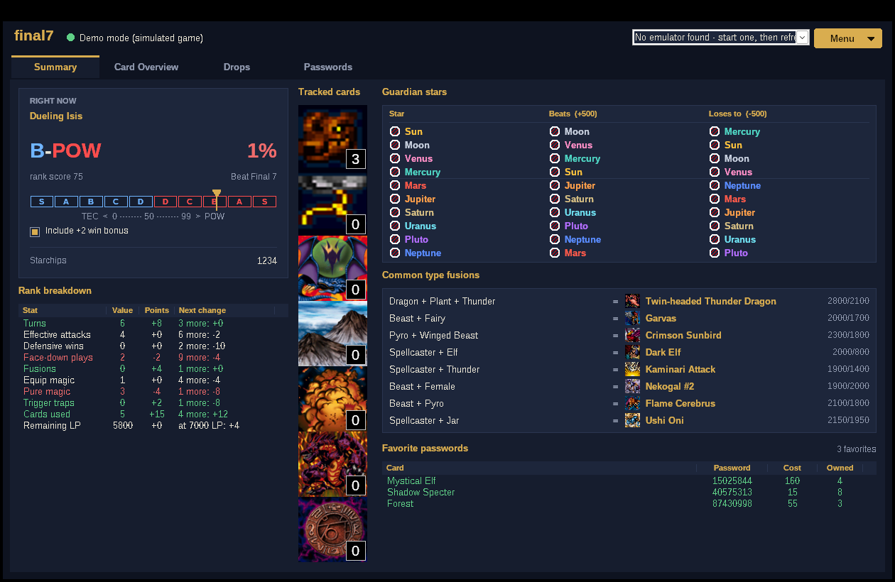

# final7

A live companion window for **Yu-Gi-Oh! Forbidden Memories** (PS1, North American version) running in an emulator on Windows. It reads the game's memory while you play and never writes to it, so your save and the emulator are never changed.

It's a single Windows program written in C. **Download [`final7.exe`](final7.exe) and double-click it.** Nothing to install, no Python, no build step.



## What it does

| Tab | What you get |
|---|---|
| **Summary** | Everything at a glance. During a duel: your live rank (letter, **POW or TEC**, 0–99 score), the TEC/POW rank meter, and a rank breakdown showing every stat (turns, effective attacks, face-downs, fusions, equips, magic, traps, cards used, LP) with its points and how far you are from the next change ("2 more: −4"). Always: your estimated chance to **Beat Final 7**, starchips, up to 7 tracked cards/types as a column of pictures with their count in your deck, a guardian star list (using the game's own star icons, read from your disc image), common type fusions (e.g. Dragon + Plant + Thunder = Twin-headed Thunder Dragon), and your favorite passwords. |
| **Card Overview** | The same list as Card Overview v2.1: the Dragon, Equip and Thunder type entries (Dragon and Thunder also count fusion subtypes, so Dragon Zombie counts as a Dragon) plus all 722 cards, each with its picture and live deck / trunk / total counts. Pick up to 7 to show on the Summary tab; they default to Dragon, Thunder, Dragon Treasure, Mountain, Widespread Ruin, Meteor B. Dragon and Megamorph. Counts update by themselves as cards go into or out of your deck. |
| **Drops** | Pick any duelist to see their S/A-POW, B/C/D and S/A-TEC drop tables and their deck pool, with the chance for each card and how many you own. Tables are learned the first time you duel someone while attached. During a duel this tab jumps to your opponent and the table your current rank earns. |
| **Passwords** | All 722 cards with their 8-digit password, starchip cost, type, attribute, level and ATK/DEF, plus how many you own. **Favorite** a card (click its Fav column, press Space, or use the Favorite button) and it shows up on the Summary tab. Filter to favorites, cards you don't own, or cards you can afford now. Double-click to copy a password. |
| **Overlay** | A small always-on-top window with just your rank and win chance, for keeping next to the emulator. |

## Using it
1. Start your emulator and load Forbidden Memories.
2. Load your save and get to the map or deck screen.
3. Start `final7.exe`. It attaches by itself if an emulator is already running. Otherwise pick the emulator from the list and choose **Attach** from the **Menu** (which also has Detach, Refresh emulator list, Demo and Overlay).

If the emulator runs as administrator, run final7 as administrator too. To look around without the game, choose **Demo** from the Menu (or start it with `final7.exe --demo`). It simulates a game playing endless duels.

The guardian star icons are read from your Forbidden Memories disc image: final7 looks for a `.bin`/`.iso` in its own folder on startup, or use **Menu → Load star icons from game disc...**. Your tracked items, favorites, duel history and learned duelist tables are saved in a `final7_data` folder next to the exe.

### Supported emulators
| Emulator | How the PS1 memory is found |
|---|---|
| DuckStation | its exported `RAM` symbol (signature fallback) |
| ePSXe | signature |
| RetroArch: SwanStation, Beetle PSX / PSX HW, PCSX ReARMed | signature in the core |
| Mednafen, pSX, PCSX-Redux (64-bit), Xebra | signature |
| BizHawk and anything else | memory scan for your loaded save |

If a method fails (for example after an emulator update), final7 falls back to scanning memory for your save. That scan takes a few seconds.

## How the numbers work
* **Rank.** Every duel starts at 50 points. Each stat adds or removes points through a table that the game loads during duels, and final7 reads that same table live. 0–49 is TEC and 50–99 is POW, so a lower score means a better TEC rank. *"Include +2 win bonus"* adds what a normal win by LP is worth (an Exodia win is +40, a deck-out win is −40). With it ticked, the badge shows the rank you'd get if you won right now.
* **Beat Final 7.** The chance of winning all of the Final 7 in a row (Seto 2nd, Guardian Sebek, Guardian Neku, Heishin 2nd, Seto 3rd, DarkNite, Nitemare), multiplying the estimate for each duel. Each estimate is a guess, not a game value: It starts from a rough difficulty guess for each duelist, moves toward your real record as you play more, and adjusts for the ATK of your five strongest deck monsters against the CPU's deck (once seen). During a duel it also follows the life-point gap.
* **Drops.** These are the opponent's real drop weights out of 2048 for the S/A-POW, B/C/D or S/A-TEC table, matching your current rank.

## Building from source (optional)
The exe in the repo is already built. To rebuild it you need MinGW-w64:
* Linux/macOS: `./build.sh` (Debian/Ubuntu: `sudo apt install gcc-mingw-w64-x86-64`)
* Windows: `build.bat` with MinGW-w64 on PATH (for example from [winlibs.com](https://winlibs.com))

Tests: `gcc -Isrc tests/test_core.c src/game.c src/demo.c src/cards_data.c -lm && ./a.out`. Add `src/emu.c -DTEST_WIN32` in a Windows build to also test attaching through the memory scan and a DuckStation-style `RAM` export.

```
src/ui.c          Win32 interface (tabs, lists, rank badge, overlay)
src/emu.c         read-only process access + PS1 RAM location per emulator
src/game.c        FM memory map, rank math, duel detection, win estimate
src/demo.c        simulated game for Demo mode
src/art.c         card and type pictures (src/art.bin, built by tools/build_art.py)
src/cards_data.c  722 cards with passwords (generated by tools/gen_cards.py from tools/cards.json)
```

## Credits
* Memory addresses: [Data Crystal RAM map](https://datacrystal.tcrf.net/wiki/Yu-Gi-Oh!_Forbidden_Memories/RAM_map) and the research notes in [Unchiga/YuGiOhForbiddenMemoriesRecomp](https://github.com/Unchiga/YuGiOhForbiddenMemoriesRecomp).
* Emulator RAM pointer signatures: adapted from [Jujstme/emu-help](https://github.com/Jujstme/emu-help) (MIT).
* App icon: Nitemare's in-game portrait (Konami), via the portrait set credited in [vincevandriel/yfm-fusion-companion](https://github.com/vincevandriel/yfm-fusion-companion).
* Card and type pictures: the image set from Card Overview v2.1 by [@mergy_](https://twitter.com/mergy_) (card art is Konami's).
* Card data and passwords: from the catalog in [vincevandriel/yfm-fusion-companion](https://github.com/vincevandriel/yfm-fusion-companion) (MIT), built on [MarceloSilvarolla/YFM-Database-and-Fusion-Guide](https://github.com/MarceloSilvarolla/YFM-Database-and-Fusion-Guide).

Yu-Gi-Oh! is a trademark of Konami. This is an unofficial fan tool and doesn't include any game files.
