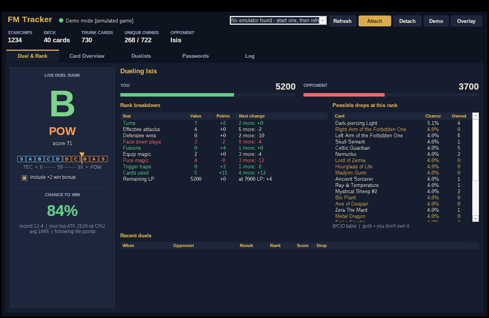

# FM Tracker

A live companion window for **Yu-Gi-Oh! Forbidden Memories** (PS1, North American version) running in an emulator on Windows. It reads the game's memory while you play and never writes to it, so your save and the emulator are never changed.

It's a single Windows program written in C. **Download [`FMTracker.exe`](FMTracker.exe) and double-click it.** Nothing to install, no Python, no build step.



## What it does

| Tab | What you get |
|---|---|
| **Duel & Rank** | Your duel rank updates live as you play: the letter (S/A/B/C/D), **POW or TEC**, and the 0–99 score. A breakdown shows every stat (turns, effective attacks, face-downs, fusions, equips, magic, traps, cards used, LP) with its points and how far you are from the next change ("2 more: −4"). Also shows both players' life points, your **chance to win** this duel, and the opponent's drop table for the rank you're on track for. |
| **Card Overview** | Pick the cards to track. Their deck, trunk and total counts update by themselves whenever a card goes into or out of your deck or chest. Changes flash green or red. Buttons let you track your whole deck or the Exodia pieces in one click. |
| **Duelists** | All 39 opponents with the game's own Free Duel win/loss record, the duels the tracker has watched (story duels included), win rate, an estimated **chance to beat** each one, and your best rank against them. The current opponent is highlighted. After you've duelled someone once, their deck and drop tables are saved and can be browsed here. |
| **Passwords** | All 722 cards with their 8-digit password, starchip cost, type, attribute, level and ATK/DEF, plus how many you own. Search, filter to cards you don't own or can afford now, and double-click a row (or press Ctrl+C) to copy the password. |
| **Overlay** | A small always-on-top window with just your rank and win chance, for keeping next to the emulator. |

## Using it
1. Start your emulator and load Forbidden Memories.
2. Load your save and get to the map or deck screen.
3. Start `FMTracker.exe`. It attaches by itself if an emulator is already running. Otherwise pick the emulator from the list (Refresh updates it) and press **Attach**.

If the emulator runs as administrator, run FM Tracker as administrator too. To look around without the game, press **Demo** (or start it with `FMTracker.exe --demo`). It simulates a game playing endless duels.

Your tracked cards, duel history and learned duelist tables are saved in a `tracker_data` folder next to the exe.

### Supported emulators
| Emulator | How the PS1 memory is found |
|---|---|
| DuckStation | its exported `RAM` symbol (signature fallback) |
| ePSXe | signature |
| RetroArch: SwanStation, Beetle PSX / PSX HW, PCSX ReARMed | signature in the core |
| Mednafen, pSX, PCSX-Redux (64-bit), Xebra | signature |
| BizHawk and anything else | memory scan for your loaded save |

If a method fails (for example after an emulator update), FM Tracker falls back to scanning memory for your save. That scan takes a few seconds.

## How the numbers work
* **Rank.** Every duel starts at 50 points. Each stat adds or removes points through a table that the game loads during duels, and FM Tracker reads that same table live. 0–49 is TEC and 50–99 is POW, so a lower score means a better TEC rank. *"Include +2 win bonus"* adds what a normal win by LP is worth (an Exodia win is +40, a deck-out win is −40). With it ticked, the badge shows the rank you'd get if you won right now.
* **Chance to win / beat.** This is an estimate, not a game value. It starts from a rough difficulty guess for each duelist, moves toward your real record as you play more, and adjusts for the ATK of your five strongest deck monsters against the CPU's deck (once seen). During a duel it also follows the life-point gap.
* **Drops.** These are the opponent's real drop weights out of 2048 for the S/A-POW, B/C/D or S/A-TEC table, matching your current rank.

## Building from source (optional)
The exe in the repo is already built. To rebuild it you need MinGW-w64:
* Linux/macOS: `./build.sh` (Debian/Ubuntu: `sudo apt install gcc-mingw-w64-x86-64`)
* Windows: `build.bat` with MinGW-w64 on PATH (for example from [winlibs.com](https://winlibs.com))

Tests: `gcc -Isrc tests/test_core.c src/game.c src/demo.c src/cards_data.c -lm && ./a.out`. Add `src/emu.c -DTEST_WIN32` in a Windows build to also test attaching through the memory scan and a DuckStation-style `RAM` export.

```
src/ui.c          Win32 interface (tabs, lists, rank badge, overlay)
src/emu.c         read-only process access + PS1 RAM location per emulator
src/game.c        FM memory map, rank math, duel detection, win estimate
src/demo.c        simulated game for Demo mode
src/cards_data.c  722 cards with passwords (generated by tools/gen_cards.py from tools/cards.json)
```

## Credits
* Memory addresses: [Data Crystal RAM map](https://datacrystal.tcrf.net/wiki/Yu-Gi-Oh!_Forbidden_Memories/RAM_map) and the research notes in [Unchiga/YuGiOhForbiddenMemoriesRecomp](https://github.com/Unchiga/YuGiOhForbiddenMemoriesRecomp).
* Emulator RAM pointer signatures: adapted from [Jujstme/emu-help](https://github.com/Jujstme/emu-help) (MIT).
* Card data and passwords: from the catalog in [vincevandriel/yfm-fusion-companion](https://github.com/vincevandriel/yfm-fusion-companion) (MIT), built on [MarceloSilvarolla/YFM-Database-and-Fusion-Guide](https://github.com/MarceloSilvarolla/YFM-Database-and-Fusion-Guide).

Yu-Gi-Oh! is a trademark of Konami. This is an unofficial fan tool and doesn't include any game files.
